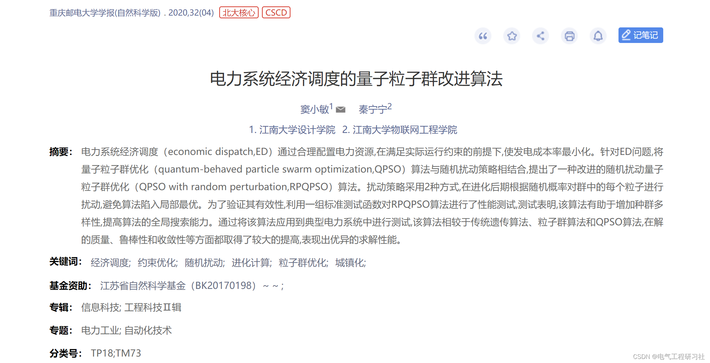
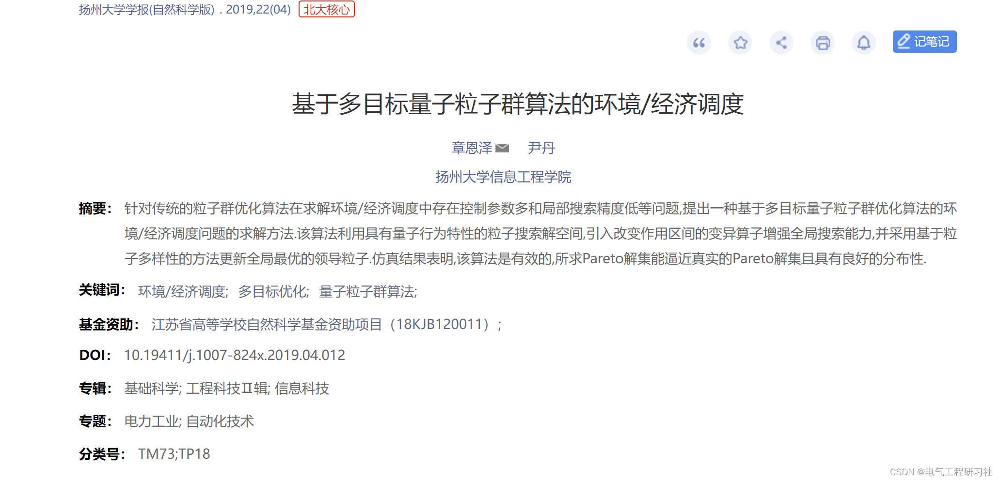
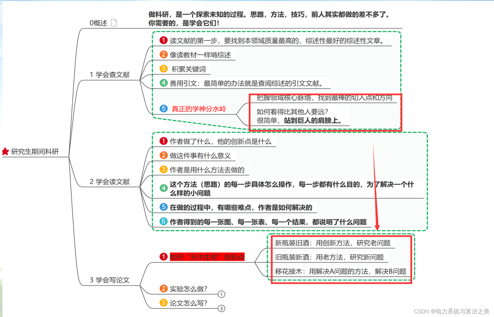
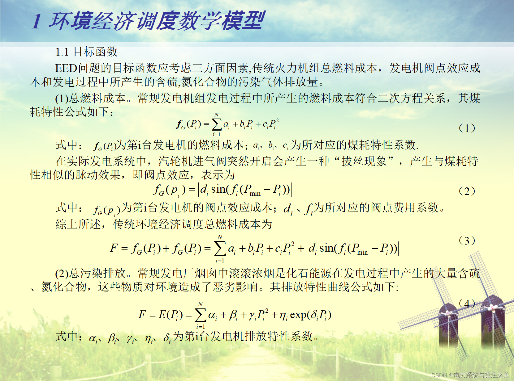
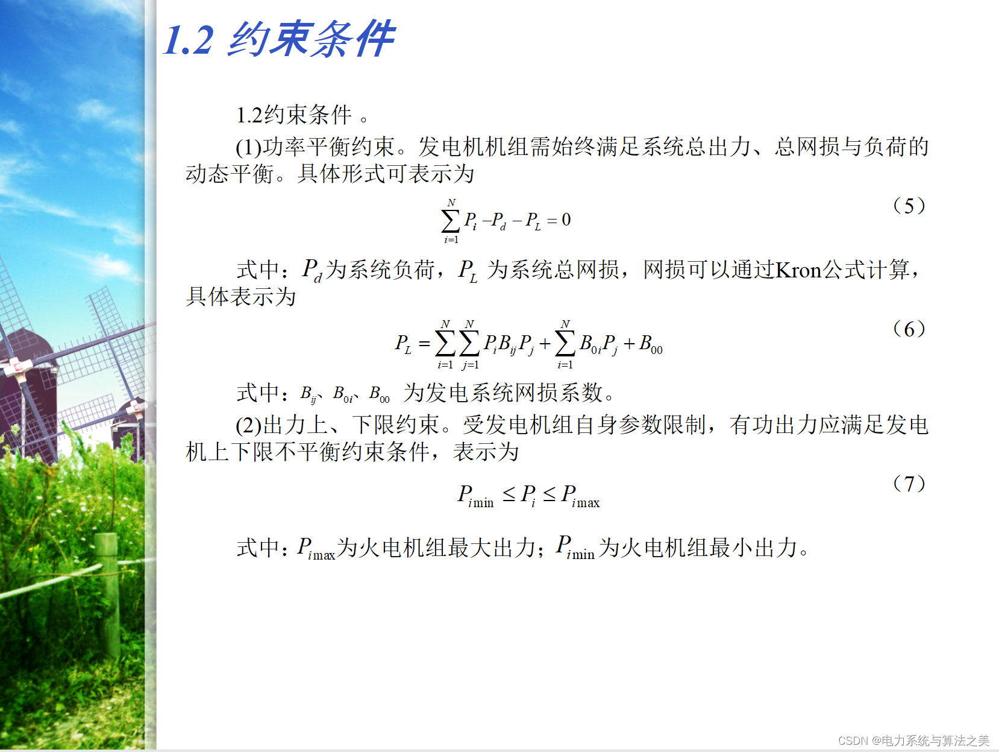
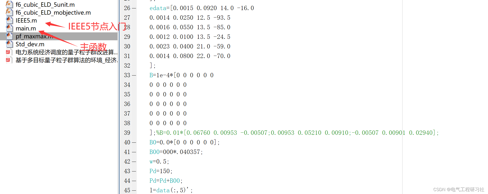
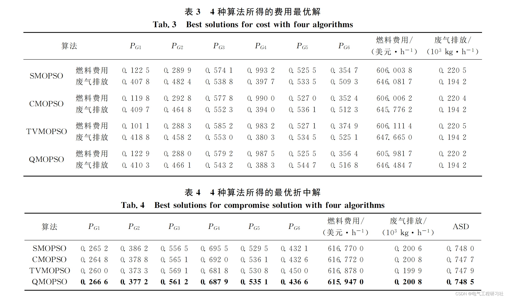

# Economic Dispatch of Power System Based on Improved Quantum Particle Swarm Algorithm (Matlab Code Implementation)

​  
📋📋📋This article's table of contents is as follows: ⛳️⛳️⛳️​1 Thesis Reproduction This thesis references the following two articles.
​  
​  
1. Overview
In 2014, China released the "National New Urbanization Plan (2014-2020)", advocating intensive and green development methods.
Accelerating the diversification of energy supply and the diversification of demand side. The large-scale integration of new energy and demand-side resources requires better methods for the operation of power systems to ensure reliability and economic efficiency. The goal of the economic dispatch (ED) problem in power system is to achieve more reasonable allocation and dispatch of electric power resources. In order to meet the actual production and living needs of power load, it should reduce the cost of power generation as much as possible. During the scheduling process, it is also necessary to satisfy the power balance and operational limits constraints among system units [1-2]. From the perspective of mathematical modeling, the ED problem can be described as a quadratic programming problem with certain constraints. Various mathematical programming methods, such as lambda iteration method, gradient method and dynamic programming, are often used to solve this type of problem. However, these traditional methods cannot obtain the optimal solution because they all employ local search techniques, often falling into local optima. On the other hand, ED problems have characteristics of discreteness, high dimensionality, nonlinearity and multi-constraints, which makes the solving methods for ED problems have great limitations. With the continuous development of artificial intelligence and the advantages of intelligent algorithms in solving complex nonlinear problems, more and more research is devoted to using intelligent algorithms to solve ED problems. Genetic algorithms (GA), Particle Swarm Optimization (PSO), and Quan- tum-behaved Particle Swarm Optimization (QPSO) have been applied to solve ED problems. Document [5] proposes a genetic algorithm based on lambda to solve the ED problem, which is faster and more robust than the lambda iterative method in large-scale systems. Document [6] proposes a genetic algorithm and an improved genetic algorithm to solve the ED problem, and it is observed that the results obtained are better than those obtained by dynamic programming methods. [7] The paper solves the ED problem with valve point effects and multiple fuels by an improved genetic algorithm with multiplier updating. Reference [9] proposes a Particle Swarm Optimization (PSO) method to solve the ED problem in power systems, and the results show that the PSO method can obtain higher quality ED problems than the Genetic Algorithm (GA) method.
The literature [11] adopted a dynamic search space reduction strategy to accelerate the optimization process of ED problems solved by PSO method. The literature [12] applied QPSO algorithm to solve ED problems and obtained better results than those of PSO and other algorithms on three test sets.
2 Mathematical Models
​  
3. Multi-objective Quantum Particle Swarm Optimization Algorithm
For details, refer to Part 4.
4. Matlab code and detailed explanation of the article. This article only showcases a portion of the code, all codes can be found in:
Editor
Editor
​  

## Images

<!-- PAYMENT_BLOCK -->

## Get this dataset

- Payment link (Stripe): [Buy now](https://buy.stripe.com/3cs8yP7sY87d0vu9AB)
- Payment QR code: 

<!-- /PAYMENT_BLOCK -->
